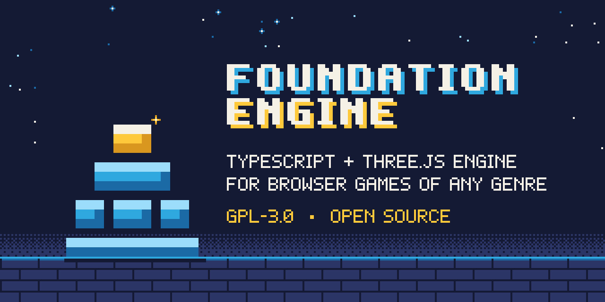

<p align="center"></p>

# Foundation Engine

Foundation Engine: a genre-neutral TypeScript and Three.js engine for browser games.

[](LICENSE)
[](https://github.com/Akilleez-QA/foundation-engine/releases)
[](package.json)

## Status

Foundation Engine is distributed as source and tooling for independently authored
browser games. It ships an author API, optional kits, templates, sectioned saves,
rendering and input services, and automated checks. The generated
[capabilities](docs/capabilities.md) identify shipped features. Browser evidence and
physical-device acceptance have separate scopes; consult the
[acceptance ledger](docs/guides/upgrade-acceptance-ledger.md) before claiming support.
The package is private to prevent accidental npm publication.

## Quickstart

Requires Git, npm and the Node range declared in [package.json](package.json).
From this checkout, these commands install the locked dependencies and run the
local source checks:

```sh
npm ci
npm run check
npm run lint
```

To run and modify a template, follow [getting started](docs/guides/getting-started.md).
Without a local game, commands select the blank template. The
[template catalog](docs/capabilities.md) and [cookbook](docs/recipes/README.md)
cover other starting points and tasks.

## What is inside

| Area | What it provides |
|---|---|
| Author API | Typed game, scene, entity, component, system, input, save and asset definitions. |
| Kernel | Module boot phases, registries, events, routing, activities and persistence owners. |
| Platform | Rendering, input actions, UI layers, audio, workers and asset leases. |
| Optional kits | Creator-selected patterns on the author API; see the [kit catalog](docs/kits/README.md). |
| Templates | Starting games with their own briefs, budgets and controls; see [templates](templates/). |
| Tooling | Static checks, focused tests, muted browser harnesses, budgets and release guards. |

Creators choose mechanics, content, devices and quality floors. The
[creator contract](docs/CREATOR-CONTRACT.md) describes extension and replacement
choices. Framework availability does not establish application acceptance.

### Not included

- Hosted accounts, matchmaking and public Internet multiplayer infrastructure.
  The network kit and shared-world template provide local-session building blocks;
  see [two players in one world](docs/recipes/two-players-one-world.md).
- A published npm library or visual editor. Games build to static output for a
  creator-selected host; see [sharing a build](docs/recipes/share-your-build.md).

## Measured

CI: local only for this documentation pass. `npm ci`, `npm run check` and
`npm run lint` passed locally on the license documentation candidate `37dc4a5`.
The focused check selected no tests; these results do not establish full CI,
browser performance or physical-device acceptance. No performance measurements
were taken for this README.

## Documentation

- [Documentation index](docs/README.md): routes through guides, standards and recipes.
- [Getting started](docs/guides/getting-started.md): create and share a game.
- [Architecture standard](docs/STANDARD.md) and [decisions](docs/adr/README.md): contracts and rationale.
- [Capabilities](docs/capabilities.md): generated inventory from source.
- [Device experience](docs/policy/DEVICE-EXPERIENCE.md): separate device and input acceptance.
- [Changelog](CHANGELOG.md): source changes and release history.

## Related projects

[Foundation Math](https://github.com/Akilleez-QA/foundation-math) is a related
Foundation project for mathematical kernels and physics research tools.
[Cstack](https://github.com/Akilleez-QA/cstack) is listed as a host in this
repository's project-family record; this checkout does not establish a pinned
Cstack interface or prove a deployed integration.

## Layout

| Path | Contents |
|---|---|
| `src/core/` | Kernel services and ownership. |
| `src/platform/` | Browser-facing services. |
| `src/domain/` | Math and simulation facilities. |
| `src/author/` | Public author API and scene runtime. |
| `src/kits/` | Optional patterns. |
| `src/features/`, `src/app/` | Features and composition root. |
| `src/dev/` | Development and test inspection API. |
| `templates/` | Starting games. |
| `perf/`, `scripts/` | Budgets, checks and tooling. |
| `tools/` | Authoring workbenches and diagnostic consumers. |
| `docs/` | Guides, contracts, decisions and evidence. |

## Contributing

Read [CONTRIBUTING.md](CONTRIBUTING.md), [governance](GOVERNANCE.md) and the
[code of conduct](CODE_OF_CONDUCT.md). [Support](SUPPORT.md) lists help channels.

## Security

Use [SECURITY.md](SECURITY.md) for vulnerability reporting.
[Third-party notices](THIRD_PARTY_NOTICES.md) preserve dependency and asset terms.

## License

This project is available under the GNU General Public License v3.0 only (GPL-3.0-only). If you want to use it to create a product or service under different terms, commercial licenses are available from Refrigeration.AI. Contact craig@nh3.biz.
