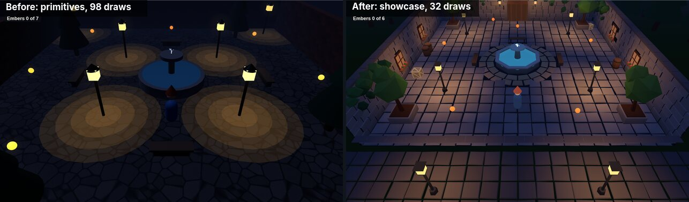
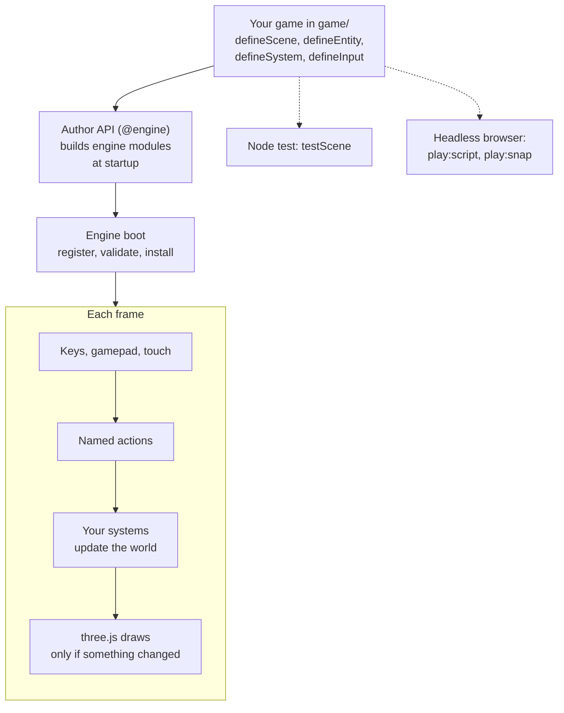
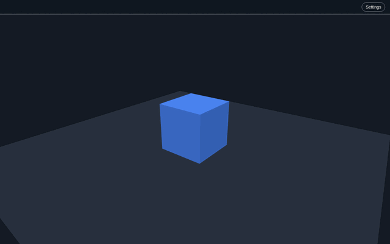

# Foundation Engine

Foundation Engine is a TypeScript engine for making 3D browser games on three.js, with tests, scripted browser
playtests and performance budgets built in from the first file.

[](LICENSE)
[](https://github.com/Akilleez-QA/foundation-engine/releases)
[](package.json)



*Left: a night courtyard from plain primitives (98 draw calls). Right: the same courtyard in the `showcase` template
(41 draw calls). Both are engine screenshots; the [art direction recipe](docs/recipes/art-direction.md) shows how the
right one is built.*

## Why

three.js draws 3D in the browser, but it leaves the rest of a game to you: the frame loop, input, saves, scenes,
randomness and tests. A hand-rolled browser game often ends up with key codes scattered through its logic, a loop that
redraws at full speed even when nothing moves, and no way to test gameplay without clicking through it.

Foundation Engine gives a game that structure from the start. You describe the game as typed data (entities, scenes,
input actions) plus small update functions called systems. The engine runs the loop, draws only when something changes,
and lets you test a scene in Node in milliseconds or drive it in a muted, headless browser. Every game has a draw-call
budget that the screenshot tool checks. The project also suits coding agents: the rules are short and machine-checked
(see [AGENTS.md](AGENTS.md)).

## How it works



When the page loads, the author API turns your definitions into engine modules; there is no separate build step for
them. Game code imports only `@engine`, optional kits (`@kits/<name>`), its own files and JSON. Systems read named actions,
never raw keys, so one action can come from a key, a gamepad button or a tap. Randomness comes from a seeded source
(`ctx.random()`), so a replay gives the same result. The same definitions run three ways: in the browser, in a fast Node
test (`testScene` presses actions, steps time and checks the world), and in a scripted headless browser (`play:script`
and `play:snap` take screenshots and check the budget). The [design description](docs/architecture/architecture.md) has the full
component map.

## Example

After [installing](#install-and-run), start a game from the smallest template. `new-game` copies the template into a
`game/` folder inside your clone of the engine, and every command then builds that game. `--id` names the game's saved
data, so choose it once. This was run on a fresh clone with Node.js 22.23.3:

```console
$ npm run new-game -- --template blank --id cube-spin --title "Cube spin"
Started 'Cube spin' (cube-spin) from the blank template in ./game (GAME.md at the root).
Scripted playtests: game/playtest/turn.json (npm run play:script -- game/playtest/turn.json).
Next: npm run play, then npm run check.
```

The code is four small TypeScript files in `game/`: `game.ts` (id, title, first scene), `main.ts` (the scene),
`turn.ts` (the input action) and `main.test.ts`. Next to them sit the brief, the budget and a playtest script. The
scene is a cube on a floor that turns a quarter each time the player presses the `turn` action (Space, gamepad A, or a
tap). Abridged from `game/main.ts`:

```ts
export const Turning = defineComponent('turning', {quarters: 0});

export const cube = defineEntity({
  id: 'cube',
  components: [
    Name({name: 'cube'}),
    Transform({y: 0.6}),
    Shape({kind: 'box', size: [1.2, 1.2, 1.2], color: 0x4f8cff}),
    Turning(),
  ],
});

export const spin = defineSystem({
  id: 'spin',
  run(ctx, dt) {
    for (const [, tr, turning] of ctx.world.query(Transform, Turning)) {
      if (ctx.input.pressed('turn')) {
        turning.quarters++;
        ctx.state.turns = turning.quarters;
      }
      const goal = (turning.quarters * Math.PI) / 2;
      if (tr.ry === goal) continue;
      tr.ry = Math.abs(goal - tr.ry) < 0.001 ? goal : tr.ry + (goal - tr.ry) * Math.min(1, dt * 12);
      ctx.world.touch();
    }
  },
});
```

`ctx.state` holds the scene's own values (here, the turn count); the browser tools report it as `world.state`.
`ctx.world.touch()` tells the engine the picture changed. The engine redraws only after a change like this (or a spawn
or removal), so a still scene costs nothing; a system that edits a component without calling it leaves the old picture
on screen. The input action is one line in `game/turn.ts`:

```ts
export default defineInput({id: 'turn', label: 'Turn', keys: ['Space'], pad: ['a'], tap: true});
```

A test presses the action and steps time, with no browser (abridged from `game/main.test.ts`). `npm run check` runs
the tests your changes affect; this runs one file directly:

```ts
test('S1: pressing turn rotates the cube a quarter turn within half a second', async () => {
  const t = await testScene(main);
  const cube = t.ctx.named('cube')!;
  t.press('turn');
  t.run(0.5);
  assert.ok(Math.abs(t.world.get(cube, Transform)!.ry - Math.PI / 2) < 0.01);
});
```

```console
$ node --import tsx --test game/main.test.ts
ok 1 - S1: pressing turn rotates the cube a quarter turn within half a second
ok 2 - a still cube does not touch the world
# pass 2
# fail 0
```

Play it in your own browser with `npm run play`:

```console
$ npm run play
  Play: http://127.0.0.1:5173/#scene/main
  Stop: Ctrl+C
```

Or let a muted headless browser play it (this needs a Chromium; see [Install and run](#install-and-run)). `play:snap`
takes the screenshot below and counts draw calls and triangles against the game's budget in `game/budgets.json`; it
fails on a page error or an over-budget scene. A still scene does not redraw by itself, so the tool forces frames to
measure it, as its budget line says. `play:script` plays the steps in
`game/playtest/turn.json` and checks the game state after each one:

```console
$ npm run play:snap
play:snap main: playtest/latest/main-desktop.png
  budget (forced redraws: the scene did not redraw on its own): 2 draws, 14 tris per rendered frame · within budget
  activity: still 1.5 s with no input: 0 renders, picture unchanged, no particles

$ npm run play:script -- game/playtest/turn.json
  PASS scene.state = "active"
  PASS world.state.turns = 0
  PASS world.state.turns = 1
play:script turn: PASS (playtest/latest/turn/report.json)
```



Outputs are trimmed to the interesting lines. The [getting started guide](docs/guides/getting-started.md) takes you through
a bigger template (a lane-dodging arcade game) step by step.

## Install and run

You need Git and Node.js 22.18 or newer.

```sh
git clone https://github.com/Akilleez-QA/foundation-engine.git
cd foundation-engine
npm ci
npm run new-game -- --template blank --id my-game --title "My game"
npm run play          # open the printed address; Space or a tap turns the cube
npm run check         # types, lints and the tests your changes affect; ends with "check: PASS"
npm run build         # static site in dist/, ready for any static host
```

For the headless browser tools (`play:snap`, `play:script`), install Playwright's Chromium once with
`npx --no-install playwright-core install chromium` (playwright-core is already a dependency), or point `ENGINE_CHROMIUM` at a Chromium you already have.
`npm test` runs every test, the engine's included.

Your game lives in your clone of the engine: commit `game/` and `GAME.md` on a branch of your own
(`git switch -c my-game`), so the game and the engine version it was tested with stay together. `game/build.brief.ts` is the
game's brief as data (goal, target devices, success criteria and how each is checked); `GAME.md` mirrors it for people,
and `npm run check` fails when the two disagree. To take a newer engine later, merge the engine's `main` into your branch; game code
that imports only `@engine` and `@kits/*` stays on the supported side
([compatibility and upgrades](docs/guides/public-compatibility.md)). One clone holds one game: `new-game` refuses
while `game/` exists (`--force` deletes and replaces it), so try another template in another clone:

| Template | Start here if you want |
|---|---|
| `blank` | one scene, one cube, one action: anything no other template fits |
| `arcade` | a score, a fail state and instant restart |
| `explorer` | a character moving between areas and using things |
| `terrain` | a character on hills and hollows |
| `learn` | a short interactive lesson |
| `expedition` | routes, objectives and inventory (many kits together) |
| `mechanics` | riding, equipment and a loaded 3D model (many kits together) |
| `showcase` | a good-looking start: palette, light presets, baked light, low-poly forms |
| `shared-world` | two or more players in one world over a local network |

## What's inside

| Part | What it gives you |
|---|---|
| Author API (`@engine`) | Typed definitions for games, scenes, entities, components, systems, input, saves and assets. |
| Engine core | One frame loop that draws on demand, scene routing with lazy loading, typed events, seeded randomness, versioned saves in browser storage. |
| Platform | three.js rendering, keyboard, gamepad and touch input, UI layers, audio, workers and a shared asset cache. |
| Kits (`@kits/<name>`) | 68 optional building blocks, such as camera, character, physics, inventory, dialogue, terrain and network. See the [kit catalog](docs/kits/README.md). |
| Templates | Nine starting games, each with its own tests, playtests and budget. |
| Tooling | `npm run check`, Node scene tests, headless browser playtests and screenshots, draw-call budgets, a static build. |

The [capabilities list](docs/capabilities.md) is generated from the code and is the full inventory.

## Status and limitations

- Version 0.2.0. It is used by cloning this repository; there is no npm package and no visual editor.
- Multiplayer covers a local session host (same machine or local network), not hosted servers or matchmaking.
- Browser checks run in headless Chromium with software rendering. A phone-sized screenshot is not proof that a game
  runs well on a real phone; test on the device. See the [device policy](docs/policy/DEVICE-EXPERIENCE.md) and the
  [limitations](docs/guides/limitations.md).
- License: GPL-3.0-only, a copyleft license. Commercial licenses are also available; see [License](#license).

## Learn more

- [Getting started](docs/guides/getting-started.md): from a clone to a game you can share.
- [Cookbook](docs/recipes/README.md): one recipe per task (models, HUD, collision, camera, saves, sharing a build).
- [Documentation index](docs/README.md): every guide, reference page and record.
- [Changelog](CHANGELOG.md) and [releases](https://github.com/Akilleez-QA/foundation-engine/releases).
- [Contributing](CONTRIBUTING.md), [support](SUPPORT.md), [security](SECURITY.md) and the
  [code of conduct](CODE_OF_CONDUCT.md).

## Related projects

Foundation Engine is one of several independent repositories by the same author in the Cstack family, a set of tools
for engineering with coding agents. You need none of them to use this engine, and none of them imports it
([interface control](docs/icd/icd-dependencies.md)).

<details>
<summary>The other repositories</summary>

| Repository | Role |
|---|---|
| [Cstack](https://github.com/Akilleez-QA/cstack) | Host: composes the family under one human approver |
| [EndoForge](https://github.com/Akilleez-QA/endoforge) | Engine: in-isolate workshop for coding agents |
| [POODO](https://github.com/Akilleez-QA/poodo) | Skill: evidence-first reasoning for agents |
| [Foundation Math](https://github.com/Akilleez-QA/foundation-math) | Foundation: mathematical kernels and research tools |
| [Foundation Film](https://github.com/Akilleez-QA/foundation-film) | Foundation: film-production acceptance checks |
| [Foundation Refrigeration](https://github.com/Akilleez-QA/foundation-refrigeration) | Foundation: refrigeration domain data and checks |
| [Foundation Robotics](https://github.com/Akilleez-QA/foundation-robotics) | Foundation: read-only motion physics checks |
| [Foundation Template](https://github.com/Akilleez-QA/foundation-template) | Template: a minimal Foundation to copy |

</details>

## Engineering records

The project keeps a software management plan, requirements traced to tests, a design description, interface and
test documents and per-release records, organized after NASA's software documentation guidance. Software
classification: a self-assessed analog of NASA NPR 7150.2D Class E (general-purpose research software), not
safety-critical; this is not a NASA compliance determination. The list is in the
[documentation index](docs/README.md#engineering-records), starting with the
[software management plan](docs/plan/software-management-plan.md) and the
[verification matrix](docs/verification/verification-matrix.md).

## License

GNU General Public License v3.0 only (GPL-3.0-only); see [LICENSE](LICENSE) and
[third-party notices](THIRD_PARTY_NOTICES.md). If you want to use it to create a product or service under different
terms, commercial licenses are available from Refrigeration.AI. Contact craig@nh3.biz.

## Brand

<details>
<summary>ASCII banner</summary>

```text
 88"""" o8""8o 88  88 88o 88 88""8o o8""8o ""88"" "88" o8""8o 88o 88
 88ooo  88  88 88  88 88"888 88  88 88oo88   88    88  88  88 88"888
 88     88  88 88  88 88  88 88  88 88  88   88    88  88  88 88  88
 88      8888   8888  88  88 88888  88  88   88   8888  8888  88  88

           [####]            88"""" 88o 88 o8"""" "88" 88o 88 88""""
        [====][====]         88ooo  88"888 88 ooo  88  88"888 88ooo
     [====][====][====]      88     88  88 88  88  88  88  88 88
  [====][====][====][====]   888888 88  88  88888 8888 88  88 888888
 [#################################################################]
```

</details>

Logo, palette and banners: [docs/brand.md](docs/brand.md).
