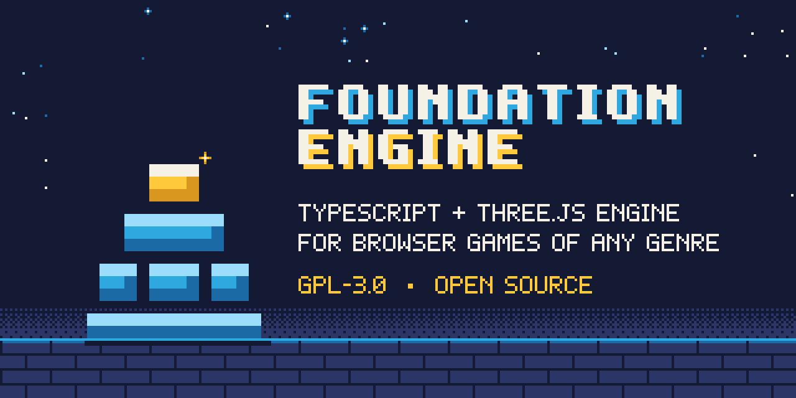

<p align="center"></p>

# Foundation Engine

Foundation Engine: a genre-neutral TypeScript and Three.js engine for browser games.

[](LICENSE)
[](https://github.com/Akilleez-QA/foundation-engine/releases)
[](package.json)

## Status

Foundation Engine is distributed as source and tooling for independently authored
browser games. It ships an author API, optional kits, templates, sectioned saves,
rendering and input services, and automated checks. The generated
[capabilities](docs/capabilities.md) identify shipped features. Browser evidence and
physical-device acceptance have separate scopes; consult the
[acceptance ledger](docs/guides/upgrade-acceptance-ledger.md) before claiming support.
The package is private to prevent accidental npm publication.

Version 0.2.0 is the latest tag (`v0.2.0`). Software classification: a self-assessed
analog of NASA NPR 7150.2D Class E (general-purpose research software), not
safety-critical; this is not a NASA compliance determination. See the
[software management plan](docs/plan/software-management-plan.md) and
[limitations](docs/guides/limitations.md).

## Quickstart

Requires Git, npm and the Node range declared in [package.json](package.json).
From this checkout, these commands install the locked dependencies and run the
local source checks:

```sh
npm ci
npm run check
npm run lint
```

To run and modify a template, follow [getting started](docs/guides/getting-started.md).
Without a local game, commands select the blank template. The
[template catalog](docs/capabilities.md) and [cookbook](docs/recipes/README.md)
cover other starting points and tasks.

## What is inside

| Area | What it provides |
|---|---|
| Author API | Typed game, scene, entity, component, system, input, save and asset definitions. |
| Kernel | Module boot phases, registries, events, routing, activities and persistence owners. |
| Platform | Rendering, input actions, UI layers, audio, workers and asset leases. |
| Optional kits | Creator-selected patterns on the author API; see the [kit catalog](docs/kits/README.md). |
| Templates | Starting games with their own briefs, budgets and controls; see [templates](templates/). |
| Tooling | Static checks, focused tests, muted browser harnesses, budgets and release guards. |

Creators choose mechanics, content, devices and quality floors. The
[creator contract](docs/CREATOR-CONTRACT.md) describes extension and replacement
choices. Framework availability does not establish application acceptance.

### Not included

- Hosted accounts, matchmaking and public Internet multiplayer infrastructure.
  The network kit and shared-world template provide local-session building blocks;
  see [two players in one world](docs/recipes/two-players-one-world.md).
- A published npm library or visual editor. Games build to static output for a
  creator-selected host; see [sharing a build](docs/recipes/share-your-build.md).

## Measured

Local run on 2026-11-08 at `a9e8cc6` (Arch Linux workstation, Node 22.23.3): `npm test`
passed 4,204 of 4,204 tests, and the `test:dmath-browser`, `test:subpath-browser` and
`test:session-browser` checks passed. Template gates and the other browser checks run in
hosted CI. Details and limits: [test report STR-main-a9e8cc6](docs/verification/reports/STR-main-a9e8cc6.md).
No performance measurements were taken for this README.

## Documentation

- [Documentation index](docs/README.md): routes through guides, standards and recipes.
- [Getting started](docs/guides/getting-started.md): create and share a game.
- [Architecture standard](docs/STANDARD.md) and [decisions](docs/adr/README.md): contracts and rationale.
- [Capabilities](docs/capabilities.md): generated inventory from source.
- [Device experience](docs/policy/DEVICE-EXPERIENCE.md): separate device and input acceptance.
- [Changelog](CHANGELOG.md): source changes and release history.
- Control documents: [plan](docs/plan/software-management-plan.md), [requirements](docs/requirements/requirements.md), [design](docs/architecture/architecture.md), [interfaces](docs/icd/icd-dependencies.md), [test plan](docs/verification/test-plan.md), [verification matrix](docs/verification/verification-matrix.md), [configuration](docs/configuration/configuration-management.md), [releases](docs/releases/README.md) and [assurance record](docs/assurance/assurance-record.md).

## Related projects

Foundation Engine belongs to the Cstack project family. It has no runtime dependency on
the other repositories and none of them imports it
([interface control](docs/icd/icd-dependencies.md)).

| Repository | Role |
|---|---|
| [Cstack](https://github.com/Akilleez-QA/cstack) | Host: composes the family under one human approver |
| [EndoForge](https://github.com/Akilleez-QA/endoforge) | Engine: in-isolate workshop for coding agents |
| [POODO](https://github.com/Akilleez-QA/poodo) | Skill: evidence-first reasoning for agents |
| [Foundation Math](https://github.com/Akilleez-QA/foundation-math) | Foundation: mathematical kernels and physics research tools |
| [Foundation Film](https://github.com/Akilleez-QA/foundation-film) | Foundation: film-production acceptance checks |
| [Foundation Refrigeration](https://github.com/Akilleez-QA/foundation-refrigeration) | Foundation: refrigeration domain data and checks |
| [Foundation Robotics](https://github.com/Akilleez-QA/foundation-robotics) | Foundation: read-only motion physics checks |
| [Foundation Template](https://github.com/Akilleez-QA/foundation-template) | Template: a minimal Foundation to copy |

## Layout

| Path | Contents |
|---|---|
| `src/core/` | Kernel services and ownership. |
| `src/platform/` | Browser-facing services. |
| `src/domain/` | Math and simulation facilities. |
| `src/author/` | Public author API and scene runtime. |
| `src/kits/` | Optional patterns. |
| `src/features/`, `src/app/` | Features and composition root. |
| `src/dev/` | Development and test inspection API. |
| `templates/` | Starting games. |
| `perf/`, `scripts/` | Budgets, checks and tooling. |
| `tools/` | Authoring workbenches and diagnostic consumers. |
| `docs/` | Guides, contracts, decisions and evidence. |

## Contributing

Read [CONTRIBUTING.md](CONTRIBUTING.md), [governance](GOVERNANCE.md) and the
[code of conduct](CODE_OF_CONDUCT.md). [Support](SUPPORT.md) lists help channels.

## Security

Use [SECURITY.md](SECURITY.md) for vulnerability reporting.
[Third-party notices](THIRD_PARTY_NOTICES.md) preserve dependency and asset terms.

## License

This project is available under the GNU General Public License v3.0 only (GPL-3.0-only). If you want to use it to create a product or service under different terms, commercial licenses are available from Refrigeration.AI. Contact craig@nh3.biz.

## Brand

```text
 88"""" o8""8o 88  88 88o 88 88""8o o8""8o ""88"" "88" o8""8o 88o 88
 88ooo  88  88 88  88 88"888 88  88 88oo88   88    88  88  88 88"888
 88     88  88 88  88 88  88 88  88 88  88   88    88  88  88 88  88
 88      8888   8888  88  88 88888  88  88   88   8888  8888  88  88

           [####]            88"""" 88o 88 o8"""" "88" 88o 88 88""""
        [====][====]         88ooo  88"888 88 ooo  88  88"888 88ooo
     [====][====][====]      88     88  88 88  88  88  88  88 88
  [====][====][====][====]   888888 88  88  88888 8888 88  88 888888
 [#################################################################]
```

Brand assets, palette and copy-paste banners: [docs/brand.md](docs/brand.md).
