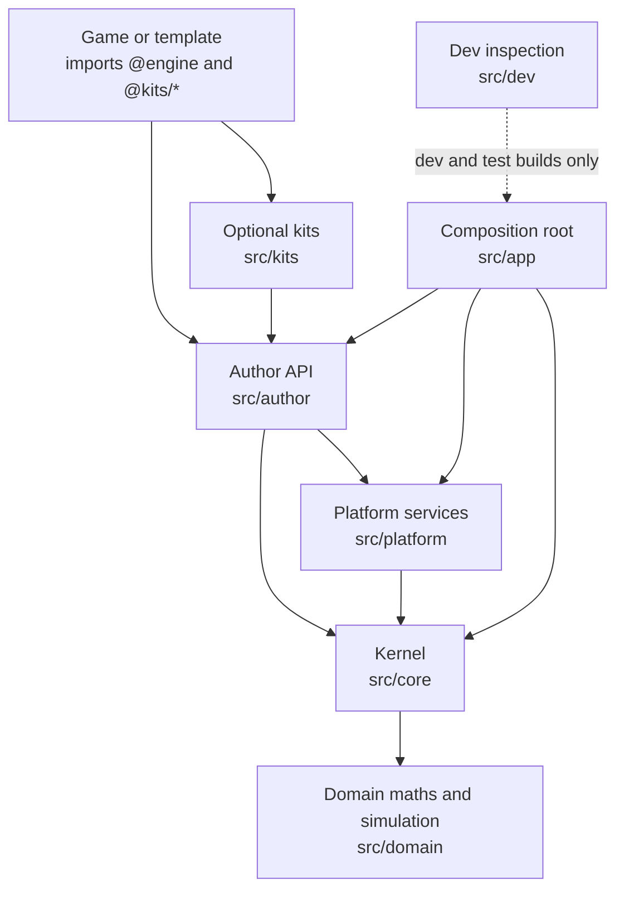
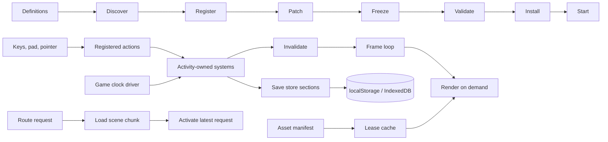

# Foundation Engine software design description

| Field | Value |
|---|---|
| Document ID | FENGINE-SDD |
| Version | 2.2 |
| Status | Baselined |
| Owner | Akilleez-QA |
| Date | 2026-11-10 |
| Baseline commit | `a9e8cc6f175b5055b18abf26579ecc432a6ac53b` |
| Applies to | foundation-engine main at baseline commit |
| Classification | Self-assessed Class E analog; not safety-critical (see [SMP §1](../plan/software-management-plan.md#1-software-classification-self-assessed)) |

> Organized after [NPR 7150.2D](https://nodis3.gsfc.nasa.gov/displayAll.cfm?Internal_ID=N_PR_7150_002D_&page_name=all), [NASA-STD-8739.8B](https://standards.nasa.gov/standard/nasa/nasa-std-87398) and the [NASA Software Engineering Handbook](https://swehb.nasa.gov/display/SWEHBVD/7.18+-+Documentation+Guidance) documentation guidance. This is not a NASA compliance determination or certification. The software classification is a self-assessed analog (Class E, not safety-critical); no NASA authority, independent verification and validation, or hazard analysis is asserted. The document describes the implementation inspected at the baseline commit.

Foundation Engine composes independently authored browser games from a typed
kernel, platform services, an author API and optional kits. This document describes
the source baseline for a reader about to change the code. [STANDARD.md](../STANDARD.md)
remains the detailed contract, and the [ADR index](../adr/README.md) holds the
reasoning behind each decision. The [creator contract](../CREATOR-CONTRACT.md)
separates reusable infrastructure from the mechanics, content and acceptance criteria
chosen by a game author.

## 1. Context and boundaries

A game imports `@engine` and selected `@kits/<name>` entry points. Templates are
small consumers; they do not define a universal game design. The application root
(`src/app/`) composes the selected game with core and platform modules. `GAME_DIR` or
`--game <dir>` selects the game; with no `game/` folder the blank template is used.
The development test API (`src/dev/`) is an inspection surface for development and
test builds, not a production API.

Dependencies point down the declared layers; ports provide explicit upward needs.
Core, platform and author code do not take mandatory kit dependencies. See
[ADR 0031](../adr/0031-layers-kits-packs-ports.md). `npm run lint:layers` and
`npm run lint:arch` enforce this (REQ-ARCH-001).

## 2. Engine components

| § | Component | Source | Responsibility | Requirements |
|---|---|---|---|---|
| 2.1 | Kernel modules, services, registries, patches | `src/core/app.ts`, `src/core/module.ts`, `src/core/registry.ts`, `src/core/patch.ts`, `src/app/` | Module boot phases, service ownership, validated registries, ordered content patches | REQ-BOOT-001, REQ-BOOT-002, REQ-BOOT-003, REQ-DATA-001, REQ-PATCH-001, REQ-APP-001 |
| 2.2 | Events | `src/core/events.ts` | One typed, synchronous event bus | REQ-EVT-001 |
| 2.3 | Activities, loop and clock | `src/core/activity/`, `src/core/clock.ts`, `src/core/player-clock.ts` | The one frame loop, render on demand, activity ownership, game time | REQ-LOOP-001, REQ-ACT-001, REQ-CLOCK-001 |
| 2.4 | Router | `src/core/router/` | Scene registry, route resolution, lazy scene loading, handover | REQ-ROUTE-001, REQ-ROUTE-002 |
| 2.5 | Saves | `src/core/save/` | One store with typed sections, migrations, quarantine, chunk store | REQ-SAVE-001, REQ-SAVE-002, REQ-SAVE-003 |
| 2.6 | Settings, feature flags, strings | `src/core/settings/`, `src/core/i18n/` | Sparse settings, flag resolution, keyed text with locale fallback | REQ-SET-001, REQ-I18N-001 |
| 2.7 | Determinism | `src/core/rng.ts`, `src/core/dmath.ts`, `src/core/ecs/`, `src/domain/` | Seeded streams, optional deterministic maths, ECS runner, fixed-step simulation host | REQ-RNG-001, REQ-DMATH-001, REQ-ECS-001, REQ-SIM-001 |
| 2.8 | Input | `src/platform/input/` | Keyboard, pointer, gamepad and touch resolved to registered actions | REQ-INPUT-001, REQ-INPUT-002 |
| 2.9 | Assets | `src/platform/assets/` | Asset manifest gate, shared lease cache, model and texture loading | REQ-ASSET-001, REQ-ASSET-002, REQ-ASSET-003 |
| 2.10 | Author API and templates | `src/author/`, `templates/` | `defineGame` and related definitions, scene runtime, starting games | REQ-GAME-001, REQ-TPL-001, REQ-COMPAT-001 |
| 2.11 | Optional kits and layering | `src/kits/`, `scripts/lint/layers.mjs`, `scripts/package-pure.mjs` | Creator-selected patterns on public author contracts | REQ-ARCH-001, REQ-PURE-001 |
| 2.12 | Development inspection and session host | `src/dev/`, `scripts/host.mjs` | Test API, replay, event trace; local multiplayer host | REQ-DEV-001, REQ-HOST-001 |
| 2.13 | Browser harness | `scripts/play/`, `scripts/silent-browser.cjs`, `scripts/perf/bench-browser.mjs` | Muted, isolated Chromium checks of built games | REQ-DMATH-002, REQ-SUBPATH-001, REQ-SESSION-001 |

Other platform folders (`src/platform/render`, `audio`, `ui`, `network`, `workers`,
`perf`) and every kit are supporting components. Their contracts are listed in the
[capability inventory](../capabilities.md) by feature ID and verified by their own
tests; they carry no SRS requirement at this baseline.

### 2.1 Kernel modules, services, registries and patches

Definitions enter module discovery and registration. Boot runs discover, register,
patch, freeze, validate, install and start in that order. Discovery orders modules
by `requires` and `optional`, honors versions and conflicts, and disables every member
of a `requires` cycle. A module that throws is isolated: its entries roll back and
dependants are disabled. A second claim on a service key, event area or registry is
rejected before install. Ordered patches complete content before registries freeze;
validation precedes installation and startup. See
[boot phases](../adr/0003-module-system-boot-phases.md),
[typed registries](../adr/0005-registries-and-typed-content.md) and
[content packs](../adr/0006-patch-layer-content-packs.md).

### 2.2 Events

One typed bus delivers each event synchronously, in subscription order, over a
snapshot of the listener list. A throwing listener is reported and the remaining
listeners still run. Probes are read on demand. See
[ADR 0004](../adr/0004-typed-event-bus.md).

### 2.3 Activities, loop and clock

`src/core/activity/loop.ts` holds the only `requestAnimationFrame` call in the app.
Activity-owned tickers request frames; with nothing invalidated no frame is scheduled.
A covered activity pauses and resumes with `dt = 0`. An activity releases what it owns
in reverse order on leave, including after a throwing enter. The game clock is
stepped only by its driver; offline catch-up is capped at 7 days. See the
[activity loop](../adr/0015-activity-loop-render-on-demand.md) and
[game clock](../adr/0033-game-clock-driver.md).

### 2.4 Router

Routing resolves a registered scene, loads its chunk and activates the current
request. A superseded load never activates. Redirect chains stop at a hop limit, and
two scenes claiming one route fail validation. See
[scene routing](../adr/0022-scene-router-lazy-loading.md).

### 2.5 Saves

Saves flow through typed sections and migrations in one store. Unreadable bytes are
quarantined before anything overwrites them. Released v0.2.0 save fixtures in
`src/core/save/fixtures/v0.2.0/` are pinned by manifest and must load with current
code. The IndexedDB chunk store writes multi-record batches atomically and compares
revisions inside the transaction. See [sectioned saves](../adr/0007-save-store-sections.md).

### 2.6 Settings, feature flags and strings

Settings are stored sparsely and projected to body classes. Feature flags resolve URL,
then override, then detection, then default; production refuses development-only flags.
Strings are keyed; a missing key in a locale falls back per key to `en`. See
[strings and locales](../adr/0021-strings-and-locales.md).

### 2.7 Determinism

`src/core/rng.ts` provides seeded streams (mulberry32 for number seeds, FNV-1a for
named streams). `src/core/dmath.ts` is an optional deterministic maths module checked
against `src/core/dmath.golden.json`. The ECS runner advances fixed steps independently
of frame rate and isolates a throwing system. The simulation host in `src/domain/sim/`
gives bit-identical state whatever the frame timing; a local host clamps a hitch at
0.25 s.

### 2.8 Input

Keyboard, pointer, gamepad and touch input resolve to registered actions. Movement is
bound by physical key code. Blur, page hide, a hidden page and an opened UI layer
cancel held input. See the [action map](../adr/0044-one-action-map.md).

### 2.9 Assets

Assets flow through a manifest and a shared lease cache. The manifest gate rejects
missing licences, bad ids, shared or absolute paths, and format or SHA-256 mistakes.
The lease cache shares one fetch per key, bounds its warm cache in bytes and never
evicts a live lease. A model that arrives after its owner left is disposed on arrival.
Renderer resources have explicit ownership and shared lifetimes. See the
[asset cache](../adr/0023-asset-manifest-and-cache.md) and
[renderer ownership](../adr/0016-renderer-pool-resource-ownership.md).

### 2.10 Author API and templates

`src/author/` exposes the definitions a game uses (`defineGame`, scenes, entities,
components, systems, input, saves, assets) and compiles them to kernel modules.
`npm run lint:game` refuses `Math.random()` and literal UI text in game code. Each
template has a `GAME.md` brief that `npm run lint:brief` checks. The retained v0.2.0
arcade template in `scripts/fixtures/compatibility/` must keep compiling and passing.

### 2.11 Optional kits and layering

Kits live in `src/kits/<name>` and are imported only as `@kits/<name>`. Core,
platform and author code never import a kit. A pure kit package
(`npm run package:pure`) must run without the engine runtime or three.js.

### 2.12 Development inspection and session host

`src/dev/` provides the development test API, event trace and replay. Replay
reproduces a recorded seeded visit exactly and refuses corrupted or oversized logs.
`scripts/host.mjs` (`npm run host`) runs a local WebSocket session host for the
shared-world template; a wrong join code closes the client with code 1008.

### 2.13 Browser harness

`scripts/silent-browser.cjs` preloads every browser check so the test browser is muted
and isolated. The harness accepts `ENGINE_CHROMIUM`, then Playwright's browser, then a
system Chrome or Chromium. Each `test:*-browser` script builds or serves a game and
writes evidence under `playtest/`.

## 3. Repository tooling

| § | Component | Source | Responsibility | Requirements |
|---|---|---|---|---|
| 3.1 | Local checks | `scripts/check.mjs`, `scripts/lint/`, `scripts/perf/budget-ratchet.mjs` | Fast check, lint chain, budget ratchet | REQ-PERF-001, REQ-TOOL-001 |
| 3.2 | CI | `.github/workflows/ci.yml`, `scripts/ci-changes.mjs`, `scripts/ci-results.mjs`, `scripts/gate-ci.mjs`, `scripts/gate-templates.mjs` | Path filter, work jobs, result aggregation, local reproduction | REQ-CI-001, REQ-CI-002, REQ-CI-003, REQ-CI-004 |
| 3.3 | Release and supply chain | `scripts/deploy-production.mjs`, `scripts/changelog.mjs`, `scripts/new-game.mjs`, `package.json` `allowScripts` | Guarded deploy, changelog fragments, scaffolding, install-script review | REQ-REL-001, REQ-CHG-001, REQ-SEC-001, REQ-SCAF-001 |
| 3.4 | Documentation control | `scripts/capabilities.mjs`, `scripts/lint/docs-claims.mjs`, `scripts/docs/check-trace.mjs`, `scripts/docs/reports.mjs` | Generated capability inventory, stale-claim lint, trace and link check, generated reports | REQ-CAP-001, REQ-DOC-001, REQ-DOC-002, REQ-EVID-001 |

### 3.1 Local checks

`npm run check` typechecks, runs the lint list and selects the tests a change can
affect. `npm run lint` runs the full lint chain, including `lint:trace`. The budget
ratchet compares scene budgets with `origin/main` (or `BUDGET_BASE`) and accepts a
raise only with a commit trailer naming the key and value.

### 3.2 CI

`ci.yml` runs a `changes` path filter, then browser and template jobs on Node 22 and a
`node-current` job on Node 26. A final `check` job runs `scripts/ci-results.mjs`, which
requires every expected job to succeed. `manifest.yml` checks the source manifest. The
[test plan](../verification/test-plan.md) lists every job and command.

### 3.3 Release and supply chain

`npm run deploy:production` refuses anything but a clean `main` equal to `origin/main`.
Release notes are one fragment per change in `changes/unreleased/`, folded by
`npm run changelog -- --fold`. `npm run new-game` refuses bad input before writing. Every
dependency install script needs a reviewed `allowScripts` entry; npm 12 and newer enforce it
at install, older npm does not (see [SECURITY.md](../../SECURITY.md#security-posture)).

### 3.4 Documentation control

`npm run capabilities` generates `docs/capabilities.json` and `docs/capabilities.md`
from the code. `npm run lint:docs-claims` fails when a scanned page calls a shipped
feature missing. `npm run lint:trace` (`scripts/docs/check-trace.mjs`) checks the
requirement trace (only matrix §2 rows count), control-document headers and every relative Markdown link.
`scripts/docs/reports.mjs` generates the version description and test reports.

## 4. Foundation contract boundary

Requirements: REQ-FND-001, REQ-FND-002, REQ-FND-003, REQ-FND-004, REQ-FND-005.

The source manifest and read-only tool inventory are build-time artifacts owned by
repository tooling, outside the running engine. Existing author validators keep
ownership of validation; the JSON schemas describe their serializable subset. No
scheduler, cache, registry, persistence owner or runtime dependency is added. See
[ADR 0156 (foundation contract)](../adr/0156-foundation-contract-baseline.md) and the
[ICD](../icd/icd-dependencies.md#4-read-only-tool-contract-version-020).

The stdio bridge (`tools/foundation_engine_bridge.py`) owns bounded, sequential request
admission and schema validation. It computes each result from the pinned schema alone
and needs only Python 3 and `schemas/read-only-tools.json`; it starts no Node process
and keeps no state between sessions. `scripts/foundation-contract.test.ts` and
`scripts/foundation-bridge.test.mjs` verify that bridge results equal the TypeScript
validators for the same inputs.

## 5. Data flow and ownership

Registered input resolves to actions. Activity-owned systems read actions and advance
state under the shared loop and game clock. Rendering responds to changes. Routing
activates only the latest request. Saves and assets have one owner each; games do not
create parallel stores or caches.

## 6. Execution, concurrency and timing

- One frame loop on `requestAnimationFrame`; activities render on demand
  ([ADR 0015](../adr/0015-activity-loop-render-on-demand.md)).
- Event delivery is synchronous; there is no event queue.
- Fixed-step simulation runs inside the frame; a hitch is clamped rather than caught up.
- Worker jobs use bounded admission, physical cancellation and current-owner delivery
  ([ADR 0062](../adr/0062-bounded-worker-admission.md)).
- Asynchronous loads (scenes, models, textures) are owned by an abort signal; a late
  result after abort is disposed, never published.
- The stdio bridge is sequential and request-only, with no cancellation.

## 7. Design decisions

Each accepted decision has an ADR. The ones that shape the components above:

| Decision | ADR | Rationale in one line |
|---|---|---|
| Fixed boot phases | [0003](../adr/0003-module-system-boot-phases.md) | Validation before installation |
| One typed event bus | [0004](../adr/0004-typed-event-bus.md) | Compile-time payload checks, one delivery order |
| Validated, freezing registries | [0005](../adr/0005-registries-and-typed-content.md) | Stable definitions for consumers |
| One save store with sections | [0007](../adr/0007-save-store-sections.md) | Typed ownership and migrations |
| One loop, render on demand | [0015](../adr/0015-activity-loop-render-on-demand.md) | Idle scenes cost nothing |
| Quality presets govern performance | [0017](../adr/0017-quality-presets.md) | One performance knob |
| Scene registry and lazy chunks | [0022](../adr/0022-scene-router-lazy-loading.md) | Per-scene code splitting |
| One asset manifest and cache | [0023](../adr/0023-asset-manifest-and-cache.md) | Provenance and shared loading |
| Budgets as contracts | [0025](../adr/0025-performance-budgets-as-contracts.md) | Limits change only by review |
| Layers, kits, packs, ports | [0031](../adr/0031-layers-kits-packs-ports.md) | Optional kits stay optional |
| One clock driven by the loop | [0033](../adr/0033-game-clock-driver.md) | One time authority |
| Creator-selectable render backend | [0078](../adr/0078-creator-selectable-render-backend.md) | WebGL2 by default, WebGPU opt-in |

Two ADR files share the number 0078 (render backend and foundation contract); both are
listed in the [ADR index](../adr/README.md).

## 8. Interfaces

External interfaces are specified in the [ICD](../icd/icd-dependencies.md): npm
dependencies, the Node and Python tool runtimes, games consuming the author API,
browsers running built output, and the read-only stdio bridge. Data items are defined
in the [data dictionary](../data/data-dictionary.md).

## 9. Quality attributes

| Attribute | How the design addresses it | Evidence |
|---|---|---|
| Maintainability | Layer rules, optional kits, ADRs for API changes | `npm run lint:layers`, `npm run lint:arch` |
| Testability | Test API over DOM scraping ([ADR 0026](../adr/0026-test-api-over-dom-scraping.md)); 566 test files at the baseline (`git ls-files '*.test.ts' '*.test.mjs' '*.regression.mjs' \| wc -l`) | `npm test` |
| Performance | Per-scene budgets, quality presets, render on demand | `npm run lint:budgets`, `npm run gate` |
| Availability of saves | Quarantine, migrations, atomic chunk writes | `src/core/save/*.test.ts` |
| Security | Untrusted browser clients; host-side authority in the network kit; reviewed install scripts | [SECURITY.md](../../SECURITY.md), [integrity guide](../guides/integrity.md) |
| Usability | Templates, briefs, keyed text, device policy | [getting started](../guides/getting-started.md), [device policy](../policy/DEVICE-EXPERIENCE.md) |

## 10. Resource use

Scene budgets live in each game's brief and in `perf/budgets.ts`; quality presets
scale them. The asset lease cache has a warm budget in bytes, and residency policies
set ceilings per preset. No resource figure in this document is a measurement; measured
results are in the [acceptance ledger](../guides/upgrade-acceptance-ledger.md) with
their revisions.

## 11. Limitations

Passing static checks or Node tests does not establish browser behavior, sustained
hardware performance or supported-device acceptance. Configured resource limits,
overload behavior, cancellation and recovery belong to the owning framework contract.
See [limitations](../guides/limitations.md).

## Change history

| Version | Date | Commit | Change | Reviewed in |
|---|---|---|---|---|
| 1.0 | 2026-11-01 | `25575b6` | Components, ownership, data flow and ADR map | PR #327 |
| 1.1 | 2026-11-01 | `70810ba` | Foundation contract boundary; bridge self-contained | PRs #333, #340, #341 |
| 2.0 | 2026-11-08 | `a9e8cc6` | Family documentation standard: metadata, numbered component sections with requirement IDs, tooling components, concurrency, decisions, quality attributes, resource use | PR #346 |
| 2.1 | 2026-11-09 | `95a883c` | §3.3 install-script enforcement qualified by npm version; §3.4 trace check counts only matrix §2 rows | PR fixing the 2026-11-09 backfill-review findings |
| 2.2 | 2026-11-10 | `4644f3c` | §4 lists REQ-FND-004 and REQ-FND-005; the foundation-contract ADR is now 0156 (it shared 0078 with the render-backend decision) | findings-sweep PR |
